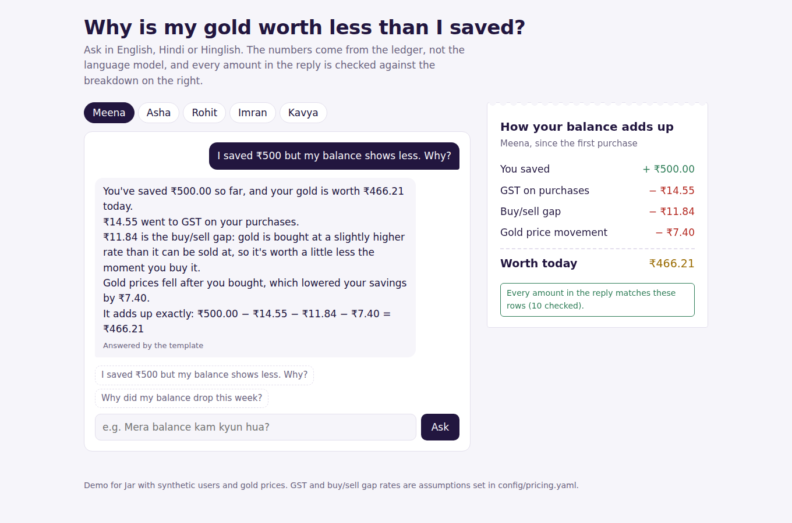
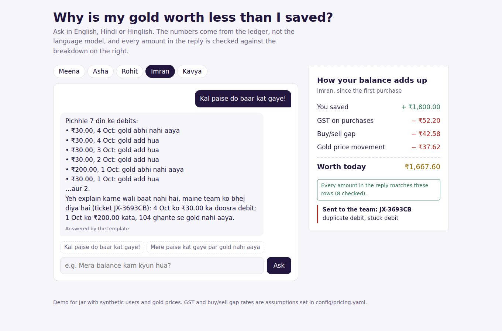

# Explain My Balance

**"I saved ₹500, why is my gold worth ₹466?"** This proof of concept answers that question in English,
Hindi or Hinglish, with numbers that add up to the paisa and that a language model can't make up.



## The problem

Recent public reviews of daily gold-savings apps keep repeating three complaints: *unexpected deductions*,
*"my balance doesn't go up when gold goes up, but drops when it falls"*, and *getting back less than I put in*.
Most of these aren't errors. They're GST, the buy/sell gap, and price movement, which users never see
laid out. When they can't see it, they assume they're being cheated, and a support agent has to work it
out by hand.

The few that *are* errors (a duplicate debit, money taken with no gold, a stuck payout) need a person,
fast, and they get buried among the explainable ones.

## What it does

| Step | How |
|---|---|
| **Work out exactly why the balance changed** | A ledger engine tracks every purchase as a lot and splits the change into: money saved, GST, the buy/sell gap, gold price movement, and cash withdrawn. The parts are checked to sum to the balance in exact arithmetic, on 300 random periods, at most 1 paisa of rounding ever absorbed. |
| **Explain it in the user's language** | Detects English, Hindi (Devanagari) or Hinglish and the question type: *why did it drop*, *why less than I saved*, *what are these debits*, *where's my withdrawal*. |
| **Make made-up numbers impossible** | Templates are built only from the engine's numbers. An LLM can optionally rephrase them, but every ₹ amount, gram figure and % in its reply is checked against the facts. If any number doesn't match, the reply is thrown away and the template answer is used. |
| **Send real problems to a person** | Duplicate debits, money taken with no gold past the refund window, auto-debits that don't match the plan, and late payouts open a ticket with the full breakdown attached. |
| **No investment advice** | "Should I sell?" gets the user's holdings and today's rate, not a recommendation. |



## Results

On 24 questions across 5 synthetic users, in all three languages:

| | Result |
|---|---|
| Question type detected | 24/24 |
| Language detected | 24/24 |
| Real problems escalated | 7/7, no false escalations |
| Replies with every number verified | 24/24 |
| Breakdown adds up exactly | 300/300 random periods |

**Read these carefully.** I wrote the questions alongside the phrase rules, so they show the system works
end to end, not real-world accuracy. Two rule gaps the evaluation did catch ("withdrew", "lower") were
fixed. The real test is a few hundred anonymised support tickets.

## Run it

```bash
pip install -r requirements.txt
uvicorn explainbal.api:app --reload      # demo at http://localhost:8000
python -m explainbal.evaluate            # writes reports/evaluation.json
pytest -q                                # 21 tests
```

Let an LLM phrase the answers (any OpenAI-compatible API; numbers are still verified):

```bash
LLM_API_KEY=... LLM_BASE_URL=https://api.groq.com/openai/v1 LLM_MODEL=llama-3.3-70b-versatile \
  uvicorn explainbal.api:app
```

## How the accounting works

Every purchase is a lot: `paid = GST + gold value at the buy rate`. Withdrawals sell the oldest grams first.
For each lot, over any period:

```
saved − GST − buy/sell gap ± price movement − cash withdrawn = change in value
```

- **Buy/sell gap** = gold value at the buy rate − the same grams at the sell rate, at the moment of purchase.
- **Price movement** = grams held × change in sell rate, plus, for grams sold, sale rate − starting rate.

These are computed separately, and their sum is checked against the actual value in exact arithmetic.
That's the test that catches accounting bugs, not just rounding.

## Assumptions (please correct me)

- GST rate (3%), buy/sell gap (2.5%), refund window (72 h) and payout window (48 h) are in
  `config/pricing.yaml`. They're stand-ins, not Jar's real numbers.
- Users, prices and transactions are synthetic. Gold falls ~3% in the final week so "why did it drop?"
  has a real answer.
- Withdrawals are modelled as selling the oldest gold first.

## What I'd do next

- Run it on anonymised support tickets and measure how many it fully answers without a person.
- Put the breakdown inside the app, not just the chat: "Why is this less?" next to the balance.
- Add the other supported languages, starting with how users actually phrase these questions.
- Voice: plug into my [Hindi voice agent](https://github.com/khushisinghal21/Two-Way-Regional-Hindi-Voice-Agent)
  so users can just ask out loud.

## Layout

```
explainbal/
  ledger.py      lots, purchases, withdrawals, and the exact breakdown
  checks.py      duplicate / stuck / mismatched debits, late payouts
  agent.py       language, intent, templates, number verification, LLM renderer, tickets
  synthetic.py   5 made-up users modelled on public complaint patterns
  evaluate.py    24-question evaluation + 300-period accounting stress test
  api.py         FastAPI + demo page (static/index.html)
config/pricing.yaml
tests/           21 tests
```
